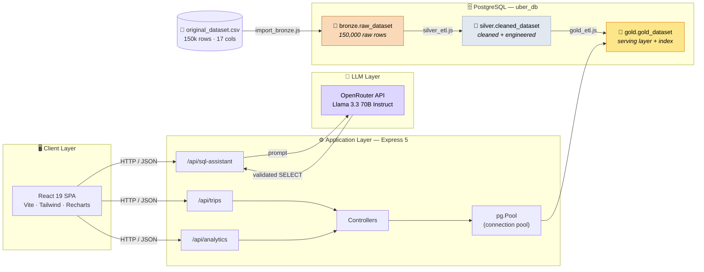

<div align="center">

# 🚕 Uber Data Platform

**An end-to-end ride-hailing analytics platform — Medallion ETL, a REST analytics API, and a natural-language → SQL assistant.**

[](https://nodejs.org)
[](https://expressjs.com)
[](https://www.postgresql.org)
[](https://react.dev)
[](https://www.typescriptlang.org)
[](https://vite.dev)
[](https://tailwindcss.com)
[](#-license)

*Advanced Database — Master's Project · Term 1*

</div>

---

## 📑 Table of Contents

- [Overview](#-overview)
- [Key Features](#-key-features)
- [Architecture](#-architecture)
- [Data Architecture — the Medallion Pipeline](#-data-architecture--the-medallion-pipeline)
- [Database Schema](#-database-schema)
- [Tech Stack](#-tech-stack)
- [Project Structure](#-project-structure)
- [API Reference](#-api-reference)
  - [Trips API](#trips-api)
  - [Analytics API](#analytics-api)
  - [SQL Assistant API](#sql-assistant-api)
- [Getting Started](#-getting-started)
- [Environment Variables](#-environment-variables)
- [ETL Runbook](#-etl-runbook)
- [Performance & Indexing](#-performance--indexing)
- [Data Quality & Validation](#-data-quality--validation)
- [Frontend](#-frontend)
- [Known Limitations & Roadmap](#-known-limitations--roadmap)
- [Security Notes](#-security-notes)
- [License](#-license)

---

## 🔭 Overview

**Uber Data Platform** turns a raw 150,000-row ride-hailing export into a governed, query-ready analytical warehouse, exposes it through a clean REST API, and lets non-technical users interrogate it in plain English.

The project demonstrates the full lifecycle of an analytical data product:

| Stage | What happens |
|---|---|
| **Ingest** | A 150k-row CSV is streamed into a raw landing table (Bronze) |
| **Transform** | Feature engineering, column normalization, cancellation-reason unification, and per-vehicle rating imputation (Silver → Gold) |
| **Serve** | An Express 5 REST API delivers paginated CRUD plus seven pre-aggregated analytics endpoints |
| **Interact** | A React 19 dashboard visualizes KPIs and charts; an LLM-powered assistant converts natural language into validated PostgreSQL `SELECT` statements |

The schema follows the **Medallion (Bronze → Silver → Gold)** pattern inside a single PostgreSQL instance, so every layer is independently auditable and the raw data is never mutated.

---

## ✨ Key Features

<table>
<tr>
<td width="50%" valign="top">

### 🗄️ Data Engineering
- **Three-layer Medallion architecture** (`bronze` → `silver` → `gold`)
- **Idempotent ETL** — `ON CONFLICT DO NOTHING`, `TRUNCATE`-then-load, transactional `BEGIN`/`COMMIT`/`ROLLBACK`
- **Feature engineering** — `pickup_hour`, `day_of_week`, `day_name`, `month`, `year`, `is_weekend`, `revenue_per_km`
- **Unified cancellation reason** — collapses 3 source columns into one analytics-ready dimension
- **Statistical imputation** — missing ratings filled with the *per-vehicle-type* mean, with auditable `*_imputed` flags
- **Covering index** designed from `EXPLAIN ANALYZE` evidence

</td>
<td width="50%" valign="top">

### 🌐 Backend & API
- **Express 5** REST API with a clean routes → controllers → models layering
- **Connection pooling** via `pg.Pool` with idle-error handling
- **Parameterized SQL everywhere** — no string-concatenated user input
- **Pagination** with `limit` / `offset` / `totalPages` metadata
- **Multi-filter analytics** — date range + vehicle type on every chart endpoint
- **Type normalization** — `pg` decimal strings safely coerced to numbers/booleans before serialization
- **PostgreSQL error-code mapping** (`23505` → `409`, `23514` → `400`)

</td>
</tr>
<tr>
<td width="50%" valign="top">

### 🤖 AI SQL Assistant
- Natural language → PostgreSQL `SELECT` via **OpenRouter** (`meta-llama/llama-3.3-70b-instruct`)
- **Schema-aware prompting** — the Gold `DDL` is injected into the system prompt
- **Read-only guardrail** — refuses `INSERT`/`UPDATE`/`DELETE`/`DROP`/`DDL`
- **Off-topic deflection** — non-analytics questions are rejected
- Low temperature (`0.1`) for deterministic SQL, plus input length validation

</td>
<td width="50%" valign="top">

### 🎨 Frontend
- **React 19 + TypeScript + Vite 7**
- **Tailwind CSS 4** with **shadcn/ui** (Radix primitives)
- **TanStack Query 5** for caching, retries, and request de-duplication
- **Recharts** dashboards (line, bar, pie)
- **react-hook-form + Zod** validated forms
- Axios instance with token injection and normalized error handling

</td>
</tr>
</table>

---

## 🏗 Architecture



**Request lifecycle (analytics endpoint):**

```
Client → GET /api/analytics/kpis?startDate=…&vehicleType=…
      → routes/analytics.js        (route matching)
      → tripAnalyticsController    (dynamic WHERE builder + parameter binding)
      → pg.Pool                    (borrowed client)
      → gold.gold_dataset          (index-backed aggregation)
      → safeNumber() normalization (numeric coercion)
      → JSON response              { total_bookings, success_rate, … }
```

---

## 🥉🥈🥇 Data Architecture — the Medallion Pipeline

Each layer has a single, explicit responsibility. No layer ever writes upward into a previous one.

### 🥉 Bronze — Raw Landing Zone

`bronze.raw_dataset` is a byte-faithful mirror of the source CSV. Nothing is renamed, cast, or dropped; the string `"null"` is the only value converted (to SQL `NULL`). This table is the system of record and the audit trail.

**Source columns (17):**

```
Date · Time · Booking ID · Booking Status · Customer ID · Vehicle Type
Cancelled Rides by Customer · Reason for cancelling by Customer
Cancelled Rides by Driver · Driver Cancellation Reason
Incomplete Rides · Incomplete Rides Reason
Booking Value · Ride Distance · Driver Ratings · Customer Rating · Payment Method
```

### 🥈 Silver — Cleaned & Engineered

`silver.cleaned_dataset` applies every deterministic transformation:

| Transformation | Detail |
|---|---|
| **Timestamp construction** | `(date + time)::TIMESTAMP` → `trip_timestamp` |
| **Temporal features** | `pickup_hour`, `day_of_week` (`DOW`), `day_name` (`FMDay`), `month`, `year`, `is_weekend` |
| **Cancellation unification** | Priority collapse: `customer_cancel_reason` → `driver_cancel_reason` → `incomplete_reason` → `'Reason Not Specified'` |
| **Status flag** | `is_cancelled = (booking_status <> 'Completed')` |
| **Rating imputation** | `NULL` ratings on completed trips filled with the per-`vehicle_type` mean (fallback `4.5`), and flagged via `driver_rating_imputed` / `customer_rating_imputed` |
| **Type hardening** | `NUMERIC(10,2)` money/distance, `NUMERIC(3,2)` ratings, `BOOLEAN` flags, `TEXT PRIMARY KEY` |

> **Why impute?** Ratings missing at random otherwise bias `AVG(driver_rating)` in the analytics endpoints. Imputing *within vehicle type* preserves the relative quality signal between segments, and the boolean flags keep the imputation reversible — a reader can always exclude imputed rows.

### 🥇 Gold — Serving Layer

`gold.gold_dataset` is the **only** table the API reads. It is deliberately denormalized (flat, wide, no joins at query time) and carries:

- `revenue_per_km` derived as `booking_value / ride_distance`, guarded by `WHEN ride_distance > 0` so zero-distance trips yield `NULL` rather than a division error
- `CHECK (driver_rating BETWEEN 0 AND 5)` and `CHECK (customer_rating BETWEEN 0 AND 5)` integrity constraints
- A purpose-built covering index (see [Performance & Indexing](#-performance--indexing))

**Layer-by-layer column evolution:**

| Bronze (raw) | Silver (cleaned) | Gold (serving) |
|---|---|---|
| `Date`, `Time` | `trip_timestamp`, `pickup_hour`, `day_of_week`, `day_name`, `month`, `year`, `is_weekend` | `trip_timestamp`, `pickup_hour`, `day_name`, `is_weekend` |
| `Cancelled Rides by Customer`, `Reason for cancelling by Customer`, `Cancelled Rides by Driver`, `Driver Cancellation Reason`, `Incomplete Rides`, `Incomplete Rides Reason` | `unified_cancellation_reason` | `unified_cancellation_reason` |
| `Booking Value`, `Ride Distance` | `booking_value`, `ride_distance` | `booking_value`, `ride_distance`, **`revenue_per_km`** ✨ |
| `Driver Ratings`, `Customer Rating` | `driver_rating`, `customer_rating`, `*_imputed` | `driver_rating`, `customer_rating`, `*_imputed` |
| `Booking Status` | `booking_status`, `is_cancelled` | `booking_status`, `is_cancelled` |

---

## 🗃 Database Schema

### `bronze.raw_dataset`
Raw text columns, positionally loaded from the CSV (17 columns, no constraints by design — data must land even if dirty).

### `silver.cleaned_dataset`

```sql
CREATE TABLE silver.cleaned_dataset (
  booking_id           TEXT PRIMARY KEY,
  customer_id          TEXT,
  vehicle_type         TEXT,
  booking_status       TEXT,
  booking_value        NUMERIC(10,2),
  ride_distance        NUMERIC(10,2),
  payment_method       TEXT,
  trip_timestamp       TIMESTAMP,
  pickup_hour          INTEGER,
  day_of_week          INTEGER,
  day_name             TEXT,
  month                INTEGER,
  year                 INTEGER,
  is_weekend           BOOLEAN,
  unified_cancellation_reason TEXT,
  driver_rating        NUMERIC(3,2),
  customer_rating      NUMERIC(3,2),
  driver_rating_imputed   BOOLEAN DEFAULT FALSE,
  customer_rating_imputed BOOLEAN DEFAULT FALSE,
  is_cancelled         BOOLEAN
);
```

### `gold.gold_dataset`

```sql
CREATE TABLE gold.gold_dataset (
  booking_id      TEXT PRIMARY KEY,
  trip_timestamp  TIMESTAMP,
  pickup_hour     INTEGER,
  day_name        TEXT,
  is_weekend      BOOLEAN,
  booking_status  TEXT,
  customer_id     TEXT,
  vehicle_type    TEXT,
  unified_cancellation_reason TEXT,
  booking_value   NUMERIC(10,2),
  ride_distance   NUMERIC(10,2),
  revenue_per_km  NUMERIC(10,2),
  driver_rating   NUMERIC(3,2) CHECK (driver_rating   BETWEEN 0 AND 5),
  customer_rating NUMERIC(3,2) CHECK (customer_rating BETWEEN 0 AND 5),
  payment_method  TEXT,
  driver_rating_imputed   BOOLEAN,
  customer_rating_imputed BOOLEAN,
  is_cancelled    BOOLEAN
);
```

**Dimensional summary**

| Dimension | Distinct values |
|---|---|
| `vehicle_type` | Sedan · Auto · eBike · Bike · Moto · Mini · XL · Go |
| `payment_method` | Cash · Credit Card · Digital Wallet |
| `booking_status` | `Completed` + cancellation/incomplete states |
| `pickup_hour` | `0`–`23` |
| `day_name` | `Monday` … `Sunday` |

---

## 🧰 Tech Stack

<table>
<tr><th align="left">Layer</th><th align="left">Technology</th><th align="left">Role</th></tr>
<tr><td rowspan="7"><b>Backend</b></td><td>Node.js (≥18)</td><td>Runtime</td></tr>
<tr><td>Express 5</td><td>HTTP server, routing, JSON middleware</td></tr>
<tr><td>PostgreSQL + <code>pg</code></td><td>Warehouse and pooled client</td></tr>
<tr><td><code>dotenv</code></td><td>Environment configuration</td></tr>
<tr><td><code>csv-parser</code></td><td>Streaming CSV ingestion</td></tr>
<tr><td><code>axios</code></td><td>OpenRouter HTTP client</td></tr>
<tr><td><code>cors</code>, <code>uuid</code>, <code>nodemon</code></td><td>Cross-origin access, IDs, dev reload</td></tr>
<tr><td rowspan="2"><b>AI</b></td><td>OpenRouter</td><td>LLM gateway</td></tr>
<tr><td>Llama 3.3 70B Instruct</td><td>Text-to-SQL generation</td></tr>
<tr><td rowspan="8"><b>Frontend</b></td><td>React 19 + TypeScript 5.9</td><td>UI and type safety</td></tr>
<tr><td>Vite 7</td><td>Dev server and bundler</td></tr>
<tr><td>Tailwind CSS 4 + shadcn/ui + Radix</td><td>Design system and accessible primitives</td></tr>
<tr><td>TanStack Query 5</td><td>Server-state caching and synchronization</td></tr>
<tr><td>Recharts 3</td><td>Analytical charts</td></tr>
<tr><td>React Router 7</td><td>Client-side routing</td></tr>
<tr><td>react-hook-form + Zod</td><td>Form state and validation</td></tr>
<tr><td>Axios + sonner + sql-formatter</td><td>HTTP, toasts, SQL highlighting</td></tr>
</table>

---

## 📁 Project Structure

```
uber_data_platform/
├── backend/                          # Express 5 REST API
│   ├── .env                          # ⚠️ secrets — gitignored
│   ├── .gitignore
│   ├── package.json
│   └── src/
│       ├── index.js                  # App entry: middleware + route mounting
│       ├── models/
│       │   └── db.js                 # pg.Pool singleton
│       ├── routes/
│       │   ├── trips.js              # /api/trips
│       │   ├── analytics.js          # /api/analytics
│       │   └── sqlAssistant.js       # /api/sql-assistant
│       ├── controllers/
│       │   ├── tripController.js             # CRUD + type normalization
│       │   ├── tripAnalyticsController.js    # KPIs, charts, filters
│       │   └── sqlAssistantController.js     # Prompt + OpenRouter call
│       ├── scripts/
│       │   ├── import_bronze.js      # CSV → bronze.raw_dataset
│       │   ├── silver_etl.js         # bronze → silver (clean + engineer)
│       │   └── gold_etl.js           # silver → gold (serve + index)
│       ├── heavy_query.sql           # EXPLAIN ANALYZE + covering index
│       └── usefull_reports_queries.sql  # Data-quality audit queries
│
├── database/
│   └── original_dataset.csv          # 150,000 rows · 17 columns
│
├── frontend/                         # React 19 SPA
│   ├── .gitignore
│   ├── package.json
│   ├── vite.config.ts                # `@` → ./src alias
│   └── src/
│       ├── App.tsx                   # Routes
│       ├── core/http-service.ts      # Axios instances + interceptors
│       ├── lib/
│       │   ├── api.ts                # Typed API client (snake_case → camelCase)
│       │   ├── types.ts, analytics-types.ts
│       │   └── query-keys.ts
│       ├── hooks/                    # use-trips, use-analytics, use-sql-assitance
│       ├── pages/
│       │   ├── DashboardPage.tsx
│       │   ├── TripsPage.tsx
│       │   ├── SQLAssistantPage.tsx
│       │   └── NotfoundPage.tsx
│       └── components/
│           ├── Dashboard/            # KPICards, 5 chart widgets, filters
│           ├── Trips/                # list, header, footer
│           ├── SQLAssistant/         # header, generated SQL, examples, tips
│           ├── Charts/               # shared chart primitives
│           └── ui/                   # shadcn/ui primitives
│
├── User Data Platform Report.pdf     # Written project report
└── README.md                         # ← you are here
```

---

## 🔌 API Reference

**Base URL:** `http://localhost:5000`
**Content-Type:** `application/json`
**CORS:** open (the SPA runs on a different origin)

### Trips API

Full CRUD over the Gold serving table.

| Method | Endpoint | Description |
|---|---|---|
| `GET` | `/api/trips` | List trips (filtered, paginated) |
| `POST` | `/api/trips` | Create a trip |
| `PATCH` | `/api/trips/:id` | Update booking status |
| `DELETE` | `/api/trips/:id` | Delete a trip |

#### `GET /api/trips`

| Query param | Type | Default | Notes |
|---|---|---|---|
| `customer_id` | string | — | Exact match |
| `startDate` | `YYYY-MM-DD` | — | `trip_timestamp >=` |
| `endDate` | `YYYY-MM-DD` | — | `trip_timestamp <=` |
| `vehicleType` | string | — | Exact match |
| `limit` | int | `10` | **Capped at 100** |
| `offset` | int | `0` | Pagination offset |

```bash
curl "http://localhost:5000/api/trips?vehicleType=Go&limit=2&startDate=2024-03-01"
```

```json
{
  "total": 4187,
  "limit": 2,
  "offset": 0,
  "totalPages": 2094,
  "trips": [
    {
      "booking_id": "CNR1234567",
      "trip_timestamp": "2024-03-09T18:42:00.000Z",
      "pickup_hour": 18,
      "day_name": "Saturday",
      "is_weekend": true,
      "booking_status": "Completed",
      "customer_id": "CID88213",
      "vehicle_type": "Go",
      "unified_cancellation_reason": "Reason Not Specified",
      "booking_value": 245.5,
      "ride_distance": 12.4,
      "revenue_per_km": 19.8,
      "driver_rating": 4.6,
      "customer_rating": 4.8,
      "payment_method": "Cash",
      "driver_rating_imputed": false,
      "customer_rating_imputed": false,
      "is_cancelled": false
    }
  ]
}
```

#### `POST /api/trips`

```bash
curl -X POST http://localhost:5000/api/trips \
  -H "Content-Type: application/json" \
  -d '{
    "date": "2024-05-14",
    "time": "09:30:00",
    "customer_id": "CID55012",
    "vehicle_type": "Sedan",
    "booking_value": 320.75,
    "ride_distance": 14.2,
    "payment_method": "Credit Card",
    "driver_rating": 4.8,
    "customer_rating": 4.9
  }'
```

**Server-side behaviour**

- `booking_id` is generated as `CNR` + 7 random digits
- `booking_status` is forced to `'Completed'`; `is_cancelled` = `false`
- `revenue_per_km` is computed in SQL: `ROUND(booking_value / ride_distance, 2)`, `NULL` when distance ≤ 0
- Both ratings are optional but must be within `0`–`5`

**Responses:** `201` created · `400` missing fields / rating out of range · `409` booking-ID collision · `500` unexpected

#### `PATCH /api/trips/:id`

```bash
curl -X PATCH http://localhost:5000/api/trips/CNR1234567 \
  -H "Content-Type: application/json" \
  -d '{ "booking_status": "Cancelled" }'
```

Setting any status other than `Completed` automatically sets `is_cancelled = true`. Returns `404` if the `booking_id` does not exist.

#### `DELETE /api/trips/:id`

```bash
curl -X DELETE http://localhost:5000/api/trips/CNR1234567
```

Returns the deleted row, or `404`.

---

### Analytics API

Every analytics endpoint accepts the same three optional filters — `startDate`, `endDate`, `vehicleType` — and applies them **server-side** with bound parameters.

| Method | Endpoint | Returns |
|---|---|---|
| `GET` | `/api/analytics/kpis` | Headline KPIs |
| `GET` | `/api/analytics/cancellation-reasons` | Cancellation reason breakdown |
| `GET` | `/api/analytics/payment-methods` | Payment method distribution |
| `GET` | `/api/analytics/vehicle-analysis` | Per-vehicle performance |
| `GET` | `/api/analytics/peak-hours` | Trips by hour of day |
| `GET` | `/api/analytics/weekday-analysis` | Trips by weekday |
| `GET` | `/api/analytics/vehicle-types` | Distinct vehicle types (filter source) |

**`GET /api/analytics/kpis`**

```bash
curl "http://localhost:5000/api/analytics/kpis?startDate=2024-01-01&vehicleType=Sedan"
```

```json
{
  "total_bookings": 24510,
  "successful_bookings": 18422,
  "total_revenue": 5841200.5,
  "success_rate": 75.16
}
```

**`GET /api/analytics/cancellation-reasons`** — share of each unified cancellation reason, ranked by frequency.

```json
{ "data": [ { "reason": "Driver Not Moving", "count": 1420, "percentage": 23.41 } ] }
```

**`GET /api/analytics/payment-methods`**

```json
{ "data": [ { "payment_method": "Cash", "count": 9201, "percentage": 37.54 } ] }
```

**`GET /api/analytics/vehicle-analysis`** — trips, average ratings, total & average revenue per vehicle type.

```json
{ "data": [ { "vehicle_type": "Sedan", "total_trips": 24510, "avg_driver_rating": 4.52,
              "avg_customer_rating": 4.61, "total_revenue": 5841200.5, "avg_booking_value": 238.3 } ] }
```

**`GET /api/analytics/peak-hours`** — `hour` (`0`–`23`) and `trip_count`, ordered by hour.

```json
{ "data": [ { "hour": 9, "trip_count": 8120 } ] }
```

**`GET /api/analytics/weekday-analysis`** — `trip_count` and `avg_revenue` per weekday, ordered **Monday → Sunday** via an explicit `CASE` sort (not lexicographic).

```json
{ "data": [ { "day_name": "Monday", "trip_count": 20114, "avg_revenue": 241.87 } ] }
```

**`GET /api/analytics/vehicle-types`**

```json
{ "vehicle_types": ["Auto", "Bike", "eBike", "Go", "Mini", "Moto", "Sedan", "XL"] }
```

---

### SQL Assistant API

#### `POST /api/sql-assistant/generate`

Converts a natural-language analytics question into a PostgreSQL `SELECT`.

```bash
curl -X POST http://localhost:5000/api/sql-assistant/generate \
  -H "Content-Type: application/json" \
  -d '{ "question": "What is the average booking value by payment method for cancelled trips?" }'
```

```json
{
  "question": "What is the average booking value by payment method for cancelled trips?",
  "sql": "SELECT payment_method, ROUND(AVG(booking_value), 2) AS avg_booking_value, COUNT(*) AS trip_count FROM gold.gold_dataset WHERE is_cancelled = TRUE GROUP BY payment_method ORDER BY avg_booking_value DESC LIMIT 100;",
  "model": "meta-llama/llama-3.3-70b-instruct"
}
```

**Guardrails (enforced in the system prompt and in the controller)**

| Rule | Behaviour |
|---|---|
| Read-only | Refuses any `INSERT`/`UPDATE`/`DELETE`/`DROP`/`TRUNCATE`/`ALTER`/`CREATE`/`GRANT`/`REVOKE` |
| Domain-bound | Rejects off-topic requests (greetings, general coding help) |
| Always bounded | Forces a `LIMIT` (default `100`) |
| Correct namespace | Always qualifies `gold.gold_dataset` |
| Schema-safe | Columns are validated against the injected Gold schema |
| Deterministic | `temperature: 0.1`, `max_tokens: 500` |
| Raw output | SQL returned as plain text — no markdown fences to strip |

**Errors**

| Status | Cause |
|---|---|
| `400` | Missing/empty question, question > 500 chars, or the model returned an `ERROR:` sentinel |
| `429` | OpenRouter rate limit exceeded |
| `500` | Missing/invalid API key, upstream failure, or empty completion |

> ⚠️ **The assistant generates SQL; it does not execute it.** The endpoint returns the statement for review — it is *not* run against the database. Treat the output as a suggestion and review it before manual execution.

---

## 🚀 Getting Started

### Prerequisites

| Requirement | Version |
|---|---|
| Node.js | ≥ 18 (20+ recommended) |
| npm | ≥ 9 |
| PostgreSQL | ≥ 14 |
| OpenRouter API key | [openrouter.ai/keys](https://openrouter.ai/keys) |

### 1 · Clone

```bash
git clone <your-repository-url>
cd uber_data_platform
```

### 2 · Create the database

```bash
psql -U postgres -c "CREATE DATABASE uber_db;"
psql -U postgres -d uber_db -c "CREATE SCHEMA IF NOT EXISTS bronze;"
psql -U postgres -d uber_db -c "
  CREATE TABLE bronze.raw_dataset (
    date TEXT, time TEXT, booking_id TEXT, booking_status TEXT, customer_id TEXT,
    vehicle_type TEXT, cancelled_by_customer TEXT, customer_cancel_reason TEXT,
    cancelled_by_driver TEXT, driver_cancel_reason TEXT, incomplete_rides TEXT,
    incomplete_reason TEXT, booking_value TEXT, ride_distance TEXT,
    driver_rating TEXT, customer_rating TEXT, payment_method TEXT
  );"
```

> The `silver` and `gold` schemas and tables are created automatically by the ETL scripts.

### 3 · Backend setup

```bash
cd backend
npm install
```

Create `backend/.env` (see [Environment Variables](#-environment-variables)):

```dotenv
DB_USER=postgres
DB_HOST=localhost
DB_NAME=uber_db
DB_PASSWORD=your_password
DB_PORT=5432
OPENROUTER_API_KEY=sk-or-v1-xxxxxxxxxxxxxxxxxxxx
PORT=5000
```

Run the ETL (see [ETL Runbook](#-etl-runbook)), then start the API:

```bash
cd src
node index.js
# 🚀 Server is running on http://localhost:5000
```

<details>
<summary><b>⚠️ Why <code>cd src</code> first?</b></summary>

`dotenv` resolves its `path` option relative to the **current working directory**, not the file. `src/index.js` loads `'../.env'` and `src/models/db.js` loads `'../../.env'` — both resolve correctly only when Node is launched from `backend/src`. Launching with `node backend/src/index.js` from the repository root leaves the variables undefined.

The ETL scripts must likewise be launched from `backend/src/scripts` (the Bronze importer reads its CSV via the relative path `../../../database/original_dataset.csv`).

A future refactor to `path.join(__dirname, '..', '.env')` would make the working directory irrelevant. See [Known Limitations](#-known-limitations--roadmap).
</details>

### 4 · Frontend setup

```bash
cd frontend
npm install
npm run dev
# ➜ Local: http://localhost:5173
```

The SPA defaults to `http://localhost:5000`. To point it elsewhere, create `frontend/.env`:

```dotenv
VITE_API_BASE_URL=http://localhost:5000
```

---

## 🔐 Environment Variables

### `backend/.env`

| Variable | Required | Default | Description |
|---|:---:|---|---|
| `DB_USER` | ✅ | — | PostgreSQL role |
| `DB_HOST` | ✅ | — | Database host |
| `DB_NAME` | ✅ | — | Database name (`uber_db`) |
| `DB_PASSWORD` | ✅ | — | PostgreSQL password |
| `DB_PORT` | ✅ | — | Database port (`5432`) |
| `OPENROUTER_API_KEY` | ✅ | — | OpenRouter key for the SQL assistant |
| `PORT` | ➖ | `5000` | HTTP listen port |

### `frontend/.env`

| Variable | Required | Default | Description |
|---|:---:|---|---|
| `VITE_API_BASE_URL` | ➖ | `http://localhost:5000` | Backend base URL (trailing slash stripped) |

> 🔒 `backend/.env` is **gitignored**. Commit a `.env.example` with placeholder values instead — never a real key.

---

## 🔄 ETL Runbook

Run the three stages **in order**. Each is idempotent and safe to re-run.

```bash
cd backend/src/scripts

# 1️⃣  Bronze — stream the CSV into bronze.raw_dataset
node import_bronze.js
#    → Import done

# 2️⃣  Silver — clean, engineer features, unify reasons, impute ratings
node silver_etl.js
#    🚀 Starting Silver Layer ETL ...
#    🧹 Truncated silver.cleaned_dataset
#    ✅ Base data inserted with feature engineering and unified reasons
#    ⭐ Ratings imputed (per vehicle type) and imputed flags set
#    🎉 Silver Layer ETL completed successfully!

# 3️⃣  Gold — enrich, constrain, and index the serving table
node gold_etl.js
#    🚀 Starting Gold Layer ETL ...
#    🛠 Gold table schema created/verified
#    ✅ Data transferred to Gold with revenue_per_km enriched
#    🎉 Gold Layer ETL completed successfully!
```

### Execution guarantees

| Stage | Guarantee |
|---|---|
| `import_bronze.js` | Streams via `csv-parser` (constant memory); converts `"null"` → SQL `NULL` |
| `silver_etl.js` | Single transaction — `COMMIT` on success, `ROLLBACK` on any error; `TRUNCATE` first for a clean rebuild; `ON CONFLICT (booking_id) DO NOTHING` |
| `gold_etl.js` | Same transactional pattern; `CREATE TABLE IF NOT EXISTS` so constraints are applied once; `revenue_per_km` guarded against zero distance |

> 💡 **Creating the covering index** is a separate, deliberate step — run `backend/src/heavy_query.sql` once the Gold table is loaded (see below).

---

## ⚡ Performance & Indexing

The indexing strategy was **derived from measurement**, not guesswork. `backend/src/heavy_query.sql` captures the method:

```sql
-- 1) Force the planner to reveal the true cost of a full scan
SET enable_indexscan = OFF;

EXPLAIN ANALYZE
SELECT vehicle_type, payment_method,
       COUNT(*) AS total_trips,
       SUM(booking_value) AS total_revenue,
       AVG(driver_rating) AS avg_driver_rating
FROM gold.gold_dataset
WHERE booking_status = 'Completed'
  AND vehicle_type = 'Uber XL'
  AND trip_timestamp >= '2024-03-01'
  AND trip_timestamp <  '2024-03-10'
GROUP BY vehicle_type, payment_method
ORDER BY total_revenue DESC;

SET enable_seqscan = ON;

-- 2) Add a covering index that matches the access pattern exactly
CREATE INDEX idx_covering_force
ON gold.gold_dataset (booking_status, vehicle_type, trip_timestamp)
INCLUDE (booking_value, payment_method, driver_rating);
```

**Why this index works**

| Design choice | Rationale |
|---|---|
| **Equality-first key order** | `booking_status` then `vehicle_type` — the two `=` predicates lead the B-tree |
| **Range column last** | `trip_timestamp` is a range predicate, so it must follow all equality columns |
| **`INCLUDE` payload** | `booking_value`, `payment_method`, `driver_rating` are projected, never filtered — an **index-only scan** avoids heap fetches entirely |
| **`enable_indexscan = OFF` baseline** | Establishes the honest sequential-scan cost before the index exists, so the improvement is measurable rather than assumed |

**Verify the plan**

```sql
EXPLAIN (ANALYZE, BUFFERS)
SELECT vehicle_type, payment_method, COUNT(*), SUM(booking_value), AVG(driver_rating)
FROM gold.gold_dataset
WHERE booking_status = 'Completed' AND vehicle_type = 'Go'
  AND trip_timestamp >= '2024-03-01' AND trip_timestamp < '2024-03-10'
GROUP BY vehicle_type, payment_method;

-- Look for:  Index Only Scan using idx_covering_force  …  Heap Fetches: 0
```

**Analytics pagination safety** — `GET /api/trips` clamps `limit` to a maximum of `100` (`Math.min(Number(limit) || 10, 100)`), so no client can request an unbounded result set.

---

## 🧪 Data Quality & Validation

`backend/src/usefull_reports_queries.sql` is the audit toolkit used to prove the pipeline's value.

### Null-reduction audit (Bronze vs Silver)

A single CTE-driven query counts nulls across all 17 Bronze columns and the 7 analytically significant Silver columns, then reports the delta and percentage improvement:

```sql
WITH bronze_stats AS ( /* SUM of CASE WHEN col IS NULL … across 17 columns */ ),
     silver_stats AS ( /* …across 7 columns */ )
SELECT b.layer, b.total_null_values,
       s.layer, s.total_null_values,
       (b.total_null_values - s.total_null_values) AS "Nulls Removed",
       ROUND(((b.total_null_values - s.total_null_values)::NUMERIC
              / NULLIF(b.total_null_values, 0)) * 100, 2) || '%' AS "Data Quality Improvement"
FROM bronze_stats b, silver_stats s;
```

### Imputation transparency

```sql
SELECT COUNT(*) AS total_completed,
       COUNT(*) FILTER (WHERE driver_rating_imputed)   AS imputed_driver,
       COUNT(*) FILTER (WHERE customer_rating_imputed) AS imputed_customer,
       ROUND(100.0 * COUNT(*) FILTER (WHERE driver_rating_imputed) / COUNT(*), 2) AS driver_imputed_pct,
       ROUND(100.0 * COUNT(*) FILTER (WHERE customer_rating_imputed) / COUNT(*), 2) AS customer_imputed_pct
FROM silver.cleaned_dataset
WHERE booking_status = 'Completed';
```

### Other audits included

- **Cancellation-reason frequency** — verifies the unification collapse left no unintended `NULL`s
- **Average rating by vehicle type** — sanity-checks the imputation's effect per segment
- **`revenue_per_km` completeness** — counts `NULL` values (expected for zero-distance trips) and averages revenue-per-km per vehicle

### Integrity constraints enforced by design

| Constraint | Layer | Effect |
|---|---|---|
| `PRIMARY KEY (booking_id)` | Silver, Gold | Duplicate trips are impossible |
| `CHECK (driver_rating BETWEEN 0 AND 5)` | Gold | Out-of-range ratings rejected at the DB (`23514` → HTTP `400`) |
| `CHECK (customer_rating BETWEEN 0 AND 5)` | Gold | Same |
| `NOT NULL` on `unified_cancellation_reason` (via `COALESCE` to a sentinel) | Silver | Downstream `GROUP BY` never drops a bucket |

---

## 🎨 Frontend

A four-route SPA consuming the API above.

| Route | Page | Highlights |
|---|---|---|
| `/` | **Trips** | Paginated, filterable trip table (TanStack Query) · create-trip form (Zod-validated) · status update · delete with confirmation dialog |
| `/dashboard` | **Dashboard** | KPI cards · peak-hours line chart · weekday chart · vehicle, payment-method and cancellation pie charts · global date/vehicle filters |
| `/sql-assistant` | **SQL Assistant** | Natural-language input → formatted SQL with syntax highlighting · schema explorer · example questions · tips |
| `*` | **404** | Not-found page |

The `AppLayout` shell renders a sticky header with `NavLink` navigation (Trips · SQL-Assistant · Dashboard) and mounts a `sonner` `<Toaster />` for notifications.

**Architectural conventions**

- **`src/core/http-service.ts`** — one raw Axios instance and one intercepted instance. The interceptor attaches `Authorization: Bearer <localStorage.auth_token>` when present, clears it on `401`, and normalizes errors into a single `Error` shape carrying `status` and `response`.
- **`src/lib/api.ts`** — the only place that knows endpoint paths. It converts the API's `snake_case` payloads to the app's `camelCase` via `toCamel`, keeping components free of transport concerns.
- **`src/hooks/`** — TanStack Query hooks (`use-trips`, `use-analytics`, `use-sql-assitance`) own all fetching, caching, and invalidation; components never call Axios directly.
- **`src/lib/query-keys.ts`** — centralized, hierarchical cache keys for predictable invalidation.

**Scripts**

```bash
npm run dev       # Vite dev server with HMR
npm run build     # tsc -b && vite build
npm run lint      # ESLint (flat config)
npm run preview   # serve the production build
```

---

## 🧭 Known Limitations & Roadmap

Documented honestly — these are the natural next steps, not hidden defects.

**Robustness**

- [ ] **Working-directory-dependent env loading.** `dotenv` paths in `index.js` and `db.js` resolve against `process.cwd()`. Refactor to `path.resolve(__dirname, '..', '.env')` so the app can be started from anywhere.
- [ ] **Sequential Bronze insert.** `import_bronze.js` awaits one `INSERT` per row inside a stream `data` handler — correct but slow for 150k rows. Batch with `pg-copy-streams` or multi-row `INSERT`.
- [ ] **No `INSERT` error handling in Bronze.** A malformed row aborts the stream silently; wrap per-row inserts and collect rejects.

**API quality**

- [ ] No automated tests — add Jest/Supertest for controllers and a test database.
- [ ] No input validation middleware — `date`/`time` in `POST /api/trips` are interpolated into a timestamp string rather than parsed and type-checked.
- [ ] No rate limiting, authentication, or authorization on any route.
- [ ] `package.json` still has the default `test` script and no `start`/`dev` scripts.

**AI assistant**

- [ ] Generated SQL is **not executed** — add a read-only execution path with a statement timeout and a `SELECT`-only allowlist.
- [ ] Prompt-injection defence relies on the system prompt alone; add an AST/parser-level validation layer (e.g. `pgsql-ast-parser`) before any execution.
- [ ] No conversation memory or query history.

**Data platform**

- [ ] No migration tool (`node-pg-migrate`, Flyway, Prisma) — DDL lives inside the ETL scripts.
- [ ] No incremental/CDC loading; every run is a full rebuild.
- [ ] `usefull_reports_queries.sql` references `silver.silver_cleaned_dataset` in one CTE, but the actual table is `silver.cleaned_dataset` — that single query needs correcting.
- [ ] Gold and Silver tables lack a `NOT NULL`/`DEFAULT` audit policy and an `updated_at` lineage column.

---

## 🔒 Security Notes

> **Action required before publishing this repository.**

1. **Rotate the exposed OpenRouter key.** The committed `backend/.env` contains a live `OPENROUTER_API_KEY` and a database password. Even though `backend/.gitignore` now excludes `.env`, **any key that has been committed to Git history remains compromised** — purge it with [`git filter-repo`](https://github.com/newren/git-filter-repo) or the [BFG Repo-Cleaner](https://rtyley.github.io/bfg-repo-cleaner/), then rotate the key at the provider.
2. **Never commit `.env`.** Commit `backend/.env.example` with placeholders.
3. **Use a least-privilege database role.** The app currently connects as `postgres`. Create a dedicated role with `SELECT` on `gold`, plus `INSERT`/`UPDATE`/`DELETE` only if the write endpoints are genuinely required.
4. **Add authentication** before exposing the API beyond localhost — every endpoint is currently public, and `CORS` accepts all origins.
5. **Pin the dependency tree.** `package-lock.json` is committed; run `npm audit` and `npm ci` in CI to catch supply-chain issues.

---

## 📄 License

Released under the **ISC License** — see `package.json`.

## 🙏 Acknowledgements

- Dataset structure inspired by public ride-hailing trip datasets
- UI primitives from [shadcn/ui](https://ui.shadcn.com) and [Radix UI](https://www.radix-ui.com)
- LLM inference via [OpenRouter](https://openrouter.ai)

---

<div align="center">

**Advanced Database — Master's Project · Term 1**

Built with PostgreSQL, Express, React, and a healthy respect for `EXPLAIN ANALYZE`.

</div>
